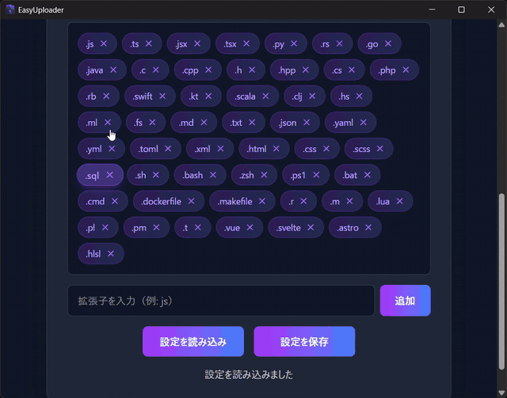

# EasyUploader



- **何を作ったか**: フォルダを選ぶと、その中のテキストファイル(ソースコード、設定、ドキュメント)を集めて、AI に読ませやすい形(概要 + ファイルツリー + 分割したテキスト)にまとめるデスクトップアプリ。
- **使い方**: 「フォルダを選択」→「テキストファイルを生成」。対象の拡張子は画面で追加・削除でき、「設定を保存」で次回も使えます。
- **技術**: Tauri 2(Rust + TypeScript / Vite)。ダークモードの UI。

*English: a small Tauri 2 desktop app (Rust + TypeScript). Pick a folder and it gathers the text/source files (configurable extensions) into a project overview, a file tree and split text files, ready to give to an AI assistant as context.*

## 動かし方

```bash
npm install
npm run tauri dev      # Node.js と Rust が必要
```

## 出力

選んだフォルダの中に `EasyUploader/` フォルダを作り、次を書き出します(デモのフォルダの例)。

- `<フォルダ名>_README.txt` — 概要、拡張子ごとのファイル数、ファイルツリー
- `<フォルダ名>_Root_1.txt` / `<フォルダ名>_<サブフォルダ名>_1.txt` — 各ファイルの内容を、フォルダごとにまとめて分割したもの

**注意**: すでに `EasyUploader/` フォルダがあると、**削除して作り直します**(`src-tauri/src/lib.rs`)。その中に手で置いたファイルは消えます。

## 詳しい説明

[このアプリについて.md](このアプリについて.md) に、拡張子の設定などの説明があります(出力のファイル名の説明は古く、上の「出力」が現在の動作です)。
